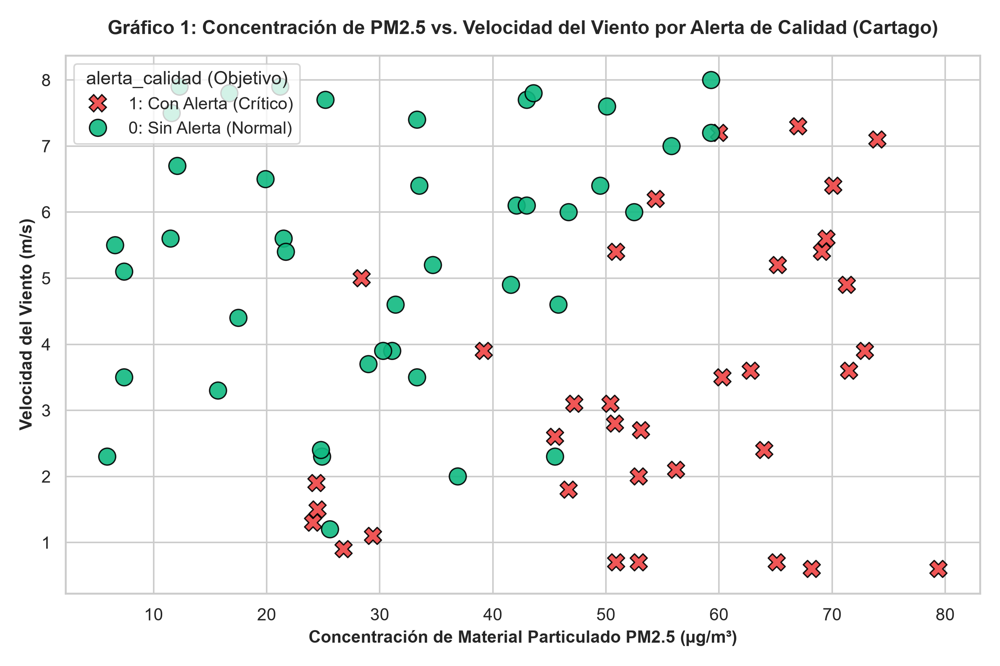
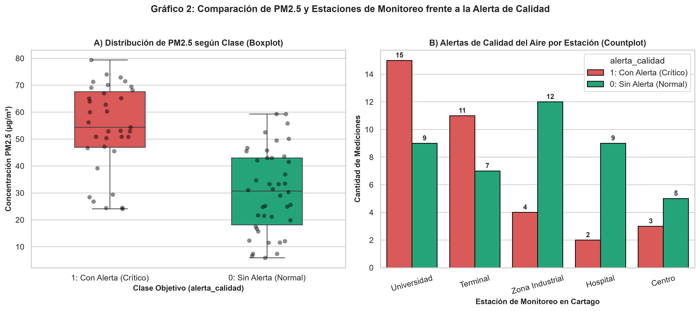
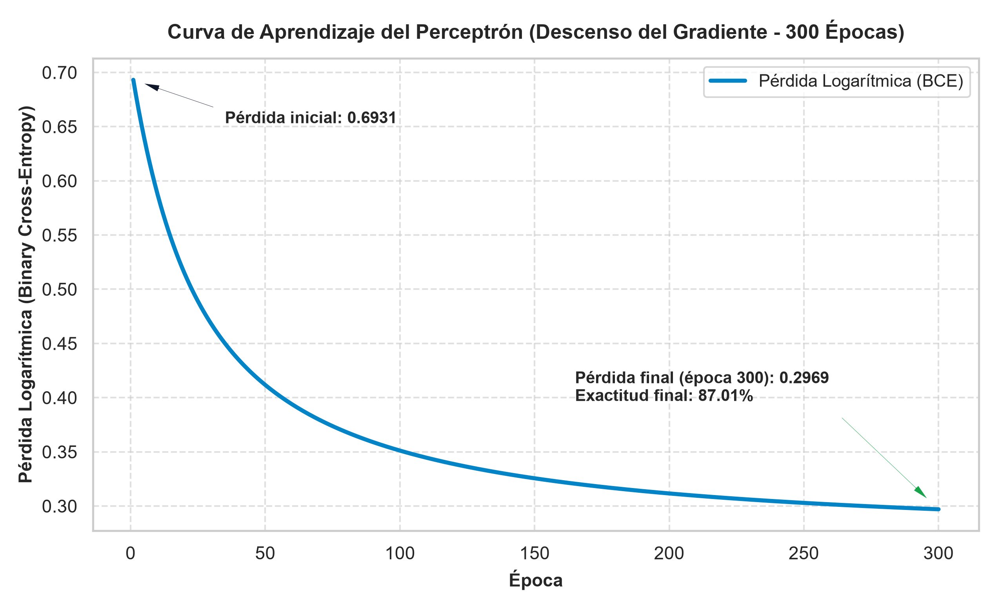
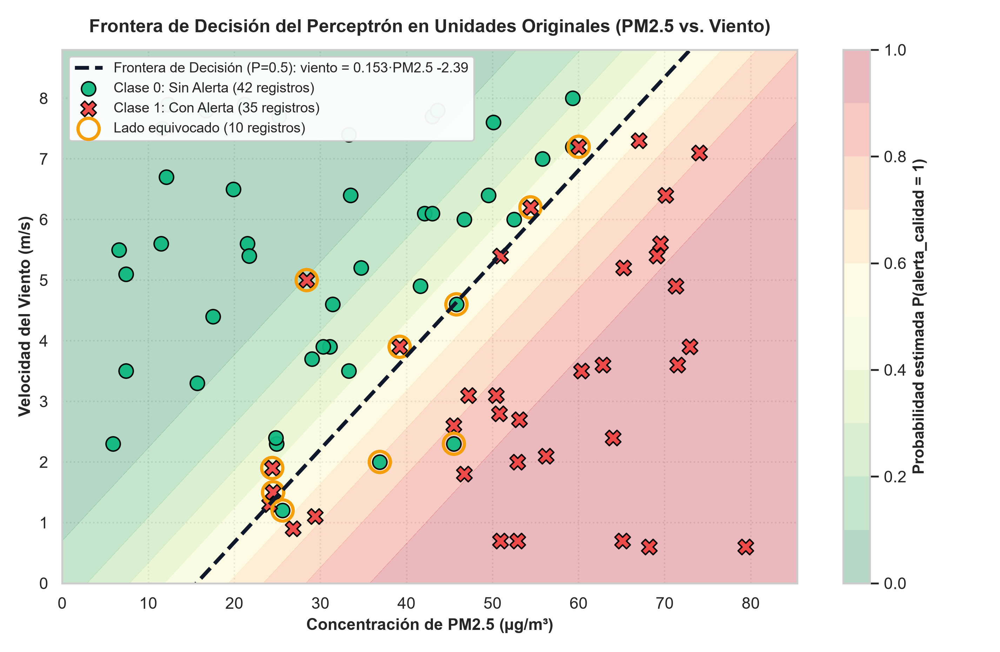

# Segundo Parcial – Inteligencia Artificial (Grupo 05)

**Asignatura:** Inteligencia Artificial · Ingeniería de Sistemas (2026-02)  
**Docente:** Ing. Jhon James Cano Sánchez  
**Grupo:** 05  
**Estudiante:** **Andrés Felipe Mejía Suaza**

**Archivo Asignado:** `data/grupo_05.csv`  
**Tema (Anexo A):** Calidad del aire – mediciones en Cartago, Valle del Cauca  
**Variables de Entrada ($x_1, x_2$):** `pm25_ugm3` ($\mu\text{g/m}^3$), `viento_m_s` ($\text{m/s}$)  
**Variable Objetivo ($y$):** `alerta_calidad` (`1` = se emitió alerta de calidad del aire, `0` = no se emitió alerta)

---

## Tarea 1. Configuración del Entorno

El proyecto cuenta con una arquitectura reproducible basada en contenedores Docker con **Python 3.12**, **NumPy**, **Pandas**, **Matplotlib** y **Seaborn**, usando el contenedor `parcial2_ia` para no entrar en conflicto con el contenedor `python_ia` de las sesiones de clase.

### Estructura del Repositorio

```text
parcial2/
├── Dockerfile
├── docker-compose.yml
├── requirements.txt
├── README.md
├── data/
│   ├── grupo_05.csv
│   └── grupo_05_limpio.csv
└── src/
    └── parcial2.py
```

### Comandos para Reproducir el Entorno (WSL + Docker)

```bash
# 1. En WSL, ubicarse en la carpeta del proyecto
mkdir -p parcial2/src parcial2/data
cd parcial2

# 2. Verificar contenedores en ejecución (detener python_ia si está activo)
docker ps
# Si python_ia está encendido: docker stop python_ia

# 3. Construir y levantar el contenedor parcial2_ia en segundo plano
docker-compose up -d --build

# 4. Ingresar al contenedor interactivo
docker exec -it parcial2_ia bash

# 5. Dentro del contenedor, ejecutar el flujo completo del parcial
cd src
python parcial2.py
exit
```

---

## Tarea 2. Carga e Inspección de Datos (`grupo_05.csv`)

Al cargar el archivo original `data/grupo_05.csv` con Pandas desde `src/parcial2.py`, se obtienen los siguientes resultados de diagnóstico inicial:

### 2.1 Primeras 5 filas (`df.head()`)

| Índice | `medicion_id` | `estacion` | `pm25_ugm3` | `viento_m_s` | `alerta_calidad` |
| :---: | :---: | :--- | :---: | :---: | :---: |
| 0 | `M001` | Terminal | 52.9 | `2,0` | 1 |
| 1 | `M002` | Universidad | 79.4 | `0.6` | 1 |
| 2 | `M003` | Zona Industrial | 12.3 | `7.9` | 0 |
| 3 | `M004` | Terminal | 43.0 | `7.7` | 0 |
| 4 | `M005` | Centro | 34.7 | `5.2` | 0 |

### 2.2 Resumen de Inspección Inicial

- **Forma del DataFrame (`df.shape`):** `(84, 5)` $\rightarrow$ **84 filas** y **5 columnas**.
- **Tipos de datos (`df.dtypes` / `df.info()`):**
  - `medicion_id`: `object` / `str` (84 no nulos)
  - `estacion`: `object` / `str` (84 no nulos)
  - `pm25_ugm3`: `float64` (84 no nulos)
  - `viento_m_s`: `object` / `str` (81 no nulos) $\leftarrow$ **Tipo incorrecto para una variable numérica**
  - `alerta_calidad`: `int64` (84 no nulos)
- **Cantidad de valores nulos por columna (`df.isnull().sum()`):**
  - `medicion_id`: `0`
  - `estacion`: `0`
  - `pm25_ugm3`: `0`
  - `viento_m_s`: `3` (`M006`, `M010` y `M021`)
  - `alerta_calidad`: `0`
- **Cantidad de filas duplicadas exactas (`df.duplicated().sum()`):** **`4` filas duplicadas** (`M004`, `M059`, `M066` y `M067`).

### 2.3 Pregunta Clave – Tarea 2

> **¿Alguna columna numérica aparece con un tipo de dato que no debería tener? ¿Por qué ocurre?**
>
> **Respuesta:** Sí. La columna numérica **`viento_m_s`** (velocidad del viento en $\text{m/s}$, que es la segunda entrada numérica $x_2$ del perceptrón) aparece con tipo de dato **`object` (`str` / texto)** en lugar de **`float64`**.  
> Esto ocurre porque **3 registros del archivo fueron exportados utilizando coma (`,`) como separador decimal en lugar de punto (`.`)**:
> - `M001` (Terminal): `"2,0"`
> - `M032` (Universidad): `"7,0"`
> - `M044` (Universidad): `"5,6"`
>
> Al encontrar cadenas con comas entre comillas en el CSV, el analizador de Pandas no puede convertir automáticamente la columna a punto flotante y la clasifica como texto.

---

## Tarea 3. Calidad y Limpieza de Datos con Pandas

Durante la auditoría del archivo `data/grupo_05.csv` se identificaron y corrigieron **4 problemas de calidad de datos**:

### Problema 1: Filas duplicadas exactas (4 registros)
- **¿Cómo se detectó?**  
  Ejecutando `df.duplicated().sum()` y `df[df.duplicated(keep=False)].sort_values("medicion_id")`, lo cual evidenció **4 filas repetidas exactamente** en todas sus columnas:
  ```text
     medicion_id     estacion  pm25_ugm3 viento_m_s  alerta_calidad
  3         M004     Terminal       43.0        7.7               0
  26        M004     Terminal       43.0        7.7               0
  10        M059  Universidad       74.0        7.1               1
  60        M059  Universidad       74.0        7.1               1
  64        M066     Terminal       60.3        3.5               1
  69        M066     Terminal       60.3        3.5               1
  65        M067       Centro        5.9        2.3               0
  70        M067       Centro        5.9        2.3               0
  ```
- **¿Qué decisión se tomó?**  
  **Eliminar** las 4 filas duplicadas conservando únicamente la primera aparición mediante `df.drop_duplicates(keep="first")` (reduciendo el dataset de 84 a 80 filas).
- **¿Por qué se tomó esa decisión?**  
  Porque comparten exactamente el mismo identificador de medición (`medicion_id`) y los mismos valores, producto de una doble exportación en el sistema de información. Conservarlas sesgaría la media y desviación estándar en el escalado y duplicaría artificialmente su peso en el descenso del gradiente.

### Problema 2: Texto (coma decimal) dentro de la columna numérica `viento_m_s` (3 registros)
- **¿Cómo se detectó?**  
  Al revisar `df.dtypes` (`viento_m_s` aparece como `str`/`object`) y filtrar con `df[df["viento_m_s"].astype(str).str.contains(",", na=False)]`:
  ```text
     medicion_id     estacion  pm25_ugm3 viento_m_s  alerta_calidad
  0         M001     Terminal       52.9        2,0               1
  33        M032  Universidad       55.8        7,0               0
  45        M044  Universidad       69.5        5,6               1
  ```
- **¿Qué decisión se tomó?**  
  **Convertir** el separador decimal reemplazando `","` por `"."` (`df["viento_m_s"].astype(str).str.replace(",", ".", regex=False)`) y transformar la columna a tipo numérico `float64` con `pd.to_numeric(..., errors="coerce")`.
- **¿Por qué se tomó esa decisión?**  
  Porque las magnitudes (`2.0`, `7.0` y `5.6` $\text{m/s}$) son mediciones meteorológicas completamente válidas dentro del rango normal de velocidad del viento en Cartago (`0.6` a `8.0` $\text{m/s}$). Corregir el formato preserva 3 observaciones reales y habilita el cálculo vectorial en NumPy.

### Problema 3: Valores faltantes / nulos en `viento_m_s` (3 registros)
- **¿Cómo se detectó?**  
  Ejecutando `df.isnull().sum()` y `df[df["viento_m_s"].isnull()]`, identificando 3 registros sin dato de velocidad del viento (`NaN`):
  - `M006` (Centro, `pm25_ugm3 = 20.5`, `viento_m_s = NaN`, `alerta_calidad = 0`)
  - `M010` (Terminal, `pm25_ugm3 = 26.4`, `viento_m_s = NaN`, `alerta_calidad = 0`)
  - `M021` (Terminal, `pm25_ugm3 = 60.1`, `viento_m_s = NaN`, `alerta_calidad = 0`)
- **¿Qué decisión se tomó?**  
  **Eliminar** las 3 filas con valores faltantes usando `df.dropna(subset=["viento_m_s"])` (pasando de 80 a 77 filas).
- **¿Por qué se tomó esa decisión?**  
  Porque `viento_m_s` es una de las dos únicas variables de entrada ($x_2$) del modelo. Imputar la media ($\sim 4.35\text{ m/s}$) introduciría ruido físico severo: por ejemplo, el registro `M021` tiene una concentración alta de $\text{PM}_{2.5}$ (`60.1` $\mu\text{g/m}^3$) pero **no generó alerta (`0`)**, lo cual en el fenómeno real solo ocurre cuando hay vientos muy fuertes ($> 7.0\text{ m/s}$) que dispersan el material particulado. Imputarle un viento promedio crearía un dato falso contradictorio.

### Problema 4: Valor extremo con unidad equivocada en `pm25_ugm3` (1 registro: `M075`)
- **¿Cómo se detectó?**  
  Al inspeccionar las estadísticas descriptivas (`df["pm25_ugm3"].describe()`) y filtrar `df[df["pm25_ugm3"] > 1000]`:
  ```text
     medicion_id     estacion  pm25_ugm3  viento_m_s  alerta_calidad
  78        M075  Universidad    70100.0         6.4               1
  ```
- **¿Qué decisión se tomó?**  
  **Corregir** la unidad dividiendo el valor entre $1000$ (`70100.0 / 1000 = 70.1` $\mu\text{g/m}^3$).
- **¿Por qué se tomó esa decisión?**  
  Porque todas las demás mediciones de $\text{PM}_{2.5}$ en Cartago se encuentran entre `5.9` y `79.4` $\mu\text{g/m}^3$. Un valor de `70100.0` corresponde exactamente a **$70.1\ \mu\text{g/m}^3$ expresado en nanogramos por metro cúbico ($\text{ng/m}^3$)**, es decir, multiplicado por un factor de $1000$ ($1\ \mu\text{g/m}^3 = 1000\text{ ng/m}^3$). Al convertirlo a `70.1` $\mu\text{g/m}^3$, el registro guarda total coherencia física con su etiqueta `alerta_calidad = 1` y con registros similares de la estación Universidad (como `M059` con `74.0` $\mu\text{g/m}^3$, viento `7.1` $\text{m/s}$ y `alerta_calidad = 1`).

---

### Resumen del Dataset Antes y Después de la Limpieza

| Métrica | Antes (`grupo_05.csv`) | Después (`grupo_05_limpio.csv`) |
| :--- | :---: | :---: |
| **Total de filas (registros)** | **84** | **77** |
| **Filas duplicadas** | 4 | 0 |
| **Valores nulos en `viento_m_s`** | 3 | 0 |
| **Valores con coma decimal en `viento_m_s`** | 3 (`str`) | 0 (`float64`) |
| **Valores con unidad errónea en `pm25_ugm3`** | 1 (`70100.0`) | 0 (corregido a `70.1`) |
| **Registros Clase `0` (`alerta_calidad = 0`, sin alerta)** | 47 | **42** ($54.55\%$) |
| **Registros Clase `1` (`alerta_calidad = 1`, con alerta)** | 37 | **35** ($45.45\%$) |

---

### Pregunta Clave – Tarea 3

> **¿Qué valor le pareció más sospechoso? Calcular la media de esa columna antes y después de corregirlo y explicar cómo habría afectado el escalado del perceptrón si no se hubiera corregido.**
>
> - **Valor más sospechoso:** El valor **`pm25_ugm3 = 70100.0`** en el registro **`M075`** (estación Universidad), que es mil veces superior al comportamiento real de la variable (`5.9` a `79.4` $\mu\text{g/m}^3$).
> - **Media de `pm25_ugm3` ANTES de corregirlo:**
>   - Sobre el archivo crudo (84 filas): **`875.00` $\mu\text{g/m}^3$** (desviación estándar = `7644.09` $\mu\text{g/m}^3$).
>   - Sobre las 77 filas válidas antes de corregir `M075`: **`950.78` $\mu\text{g/m}^3$** (desviación estándar = `7983.79` $\mu\text{g/m}^3$).
> - **Media de `pm25_ugm3` DESPUÉS de corregirlo (`70100.0` $\rightarrow$ `70.1` $\mu\text{g/m}^3$):**
>   - Sobre el archivo limpio final (77 filas): **`41.30` $\mu\text{g/m}^3$** (`41.2974` $\mu\text{g/m}^3$, con desviación estándar = **`19.59` $\mu\text{g/m}^3$**). *(Nota: si se hubiera eliminado la fila quedando 76 registros, la media sería `40.92` $\mu\text{g/m}^3$).*
> - **Efecto sobre el escalado del perceptrón si NO se hubiera corregido:**  
>   La estandarización Z-score calcula $z_1 = \frac{x_1 - \mu_1}{\sigma_1}$. Sin corregir `70100.0`, la media se dispara a **`950.78`** y la desviación estándar a **`7983.79`**. Como consecuencia:
>   1. **Colapso de varianza en los datos reales:** Las 76 mediciones normales (entre `5.9` y `79.4` $\mu\text{g/m}^3$) quedarían comprimidas en un intervalo minúsculo de valores estandarizados entre $z_1 = -0.118$ y $z_1 = -0.109$ (una diferencia de apenas $0.009$ unidades entre el aire más limpio y el más contaminado), mientras que `M075` tendría $z_1 = +8.66$.
>   2. **Degradación del aprendizaje:** Durante el descenso del gradiente ($dw = \frac{1}{m} X^T (\hat{y} - y)$), el único punto extremo ($z_1 = +8.66$) dominaría la derivada parcial respecto a $w_1$, impidiendo que el perceptrón distinga el umbral real de $\text{PM}_{2.5}$ para las demás 76 mediciones y reduciendo drásticamente la exactitud del clasificador.

---

## Tarea 4. Visualización con Seaborn

A partir del conjunto de datos depurado (`data/grupo_05_limpio.csv`, 77 registros válidos), se generaron dos visualizaciones estadísticas utilizando **Seaborn** y **Matplotlib**:

### 4.1 Gráfico 1: Dispersión de `pm25_ugm3` vs. `viento_m_s` coloreada por `alerta_calidad`



- **¿Qué muestra el gráfico?**  
  Muestra la distribución bidimensional de las 77 mediciones válidas de Cartago relacionando la concentración de material particulado fino $\text{PM}_{2.5}$ (`pm25_ugm3`, eje horizontal en $\mu\text{g/m}^3$) y la velocidad del viento (`viento_m_s`, eje vertical en $\text{m/s}$), diferenciando por color y marcador la variable objetivo `alerta_calidad` (`0`: Sin Alerta en círculos verdes, $n=42$; `1`: Con Alerta en equis rojas, $n=35$).
- **¿Qué conclusión se extrae?**  
  Se observa una relación inversa clara que gobierna la activación de alertas ambientales en Cartago:
  1. Los episodios **con alerta (`alerta_calidad = 1`)** se agrupan hacia la derecha y parte inferior del plano, combinando **altas concentraciones de $\text{PM}_{2.5}$** (media de **`54.26` $\mu\text{g/m}^3$**, mediana de **`54.40` $\mu\text{g/m}^3$**, rango `24.1` a `79.4` $\mu\text{g/m}^3$) con **baja velocidad del viento** (media de **`3.34` $\text{m/s}$**, mediana de **`3.10` $\text{m/s}$**). Incluso niveles moderados de $\text{PM}_{2.5}$ (`24.1` a `30.0` $\mu\text{g/m}^3$) disparan alerta cuando el viento cae por debajo de `2.0` $\text{m/s}$ debido al estancamiento atmosférico.
  2. Los episodios **sin alerta (`alerta_calidad = 0`)** se ubican en la región superior e izquierda, caracterizados por **menor carga de $\text{PM}_{2.5}$** (media de **`30.50` $\mu\text{g/m}^3$**, mediana de **`30.70` $\mu\text{g/m}^3$**) y **vientos fuertes** (media de **`5.40` $\text{m/s}$**, mediana de **`5.60` $\text{m/s}$**). Cuando el viento supera los `6.0` $\text{m/s}$, logra dispersar concentraciones de hasta `59.3` $\mu\text{g/m}^3$ (`M027` y `M057`) evitando la declaratoria de alerta.
  3. Ambas clases son **aproximadamente separables mediante una frontera diagonal**, validando el uso de un perceptrón con entradas `pm25_ugm3` y `viento_m_s`.

---

### 4.2 Gráfico 2: Comparación de `pm25_ugm3` entre Clases (`sns.boxplot`) y Alertas por Estación (`sns.countplot`)



- **¿Qué muestra el gráfico?**  
  - **Panel A (`sns.boxplot`):** Compara la distribución estadística (mediana, rango intercuartílico y dispersión individual) de la variable numérica `pm25_ugm3` entre la Clase `0` (Sin Alerta) y la Clase `1` (Con Alerta).
  - **Panel B (`sns.countplot`):** Compara la frecuencia de mediciones con alerta (`1`) y sin alerta (`0`) en cada una de las 5 estaciones de monitoreo de Cartago (`Universidad`, `Terminal`, `Zona Industrial`, `Hospital` y `Centro`).
- **¿Qué conclusión se extrae?**  
  1. **Diferencia contundente en niveles de $\text{PM}_{2.5}$ (Panel A):** La mediana de $\text{PM}_{2.5}$ en los eventos con alerta (**`54.40` $\mu\text{g/m}^3$**, con rango intercuartílico $Q_1 = 46.95$ a $Q_3 = 67.60\ \mu\text{g/m}^3$) es un **$77.2\%$ más alta** que la mediana de los eventos sin alerta (**`30.70` $\mu\text{g/m}^3$**, con $Q_1 = 18.10$ a $Q_3 = 43.00\ \mu\text{g/m}^3$). Más del $75\%$ de las alertas ocurren por encima de `46.95` $\mu\text{g/m}^3$.
  2. **Focos críticos geográficos en Cartago (Panel B):** Las estaciones **Universidad** (**15 alertas** de 24 mediciones, **$62.5\%$**) y **Terminal** (**11 alertas** de 18 mediciones, **$61.1\%$**) concentran conjuntamente **`26` de las `35` alertas totales ($74.29\%$)** del municipio, debido al alto flujo de transporte intermunicipal/estudiantil y menor ventilación urbana (`4.06` y `3.65` $\text{m/s}$, respectivamente). En cambio, **Hospital** ($2/11$ alertas, $18.2\%$) y **Zona Industrial** ($4/16$ alertas, $25.0\%$) presentan menor proporción de alertas gracias a corredores de viento más abiertos (velocidades medias de `5.95` y `5.19` $\text{m/s}$, respectivamente).

#### Resumen Estadístico por Estación (`df.groupby("estacion")`)

| Estación en Cartago | Mediciones Válidas | $\text{PM}_{2.5}$ Promedio ($\mu\text{g/m}^3$) | Viento Promedio ($\text{m/s}$) | Alertas (`alerta_calidad = 1`) | Tasa de Alerta (%) |
| :--- | :---: | :---: | :---: | :---: | :---: |
| **Universidad** | 24 | `43.33` | `4.06` | **15** | **`62.50%`** |
| **Terminal** | 18 | **`47.25`** | **`3.65`** | **11** | **`61.11%`** |
| **Zona Industrial** | 16 | `35.79` | `5.19` | 4 | `25.00%` |
| **Centro** | 8 | `35.84` | `4.01` | 3 | `37.50%` |
| **Hospital** | 11 | `39.10` | `5.95` | 2 | `18.18%` |

---

## Tarea 5. Perceptrón desde Cero con NumPy

El modelo se construyó **100% desde cero utilizando exclusivamente NumPy** (sin Scikit-Learn ni librerías externas de Machine Learning) dentro de `src/parcial2.py`.

### 5.1 Parámetros de Escalado Guardados (`X_std = (X - media_X) / desv_X`)

| Variable de Entrada | Columna | Media de Entrenamiento ($\mu$) | Desviación Estándar ($\sigma$) |
| :--- | :---: | :---: | :---: |
| **$x_1$: Material Particulado $\text{PM}_{2.5}$** | `pm25_ugm3` | **`41.2974` $\mu\text{g/m}^3$** | **`19.4840` $\mu\text{g/m}^3$** |
| **$x_2$: Velocidad del Viento** | `viento_m_s` | **`4.4636` $\text{m/s}$** | **`2.2419` $\text{m/s}$** |

### 5.2 Funciones Implementadas y Entrenamiento por Descenso del Gradiente

- **Función Sigmoide:** $\sigma(z) = \frac{1}{1 + e^{-z}}$
- **Predicción de Probabilidad:** $\hat{y} = \sigma(X_{\text{std}} \cdot w + b)$
- **Pérdida Logarítmica (Binary Cross-Entropy):** $L(y, \hat{y}) = -\frac{1}{m} \sum_{i=1}^{m} \left[ y_i \ln(\hat{y}_i) + (1 - y_i)\ln(1 - \hat{y}_i) \right]$
- **Gradientes Analíticos:** $dw = \frac{1}{m} X_{\text{std}}^T (\hat{y} - y)$, $\quad db = \frac{1}{m} \sum_{i=1}^{m} (\hat{y}_i - y_i)$
- **Hiperparámetros:** Tasa de aprendizaje $\alpha = 0.1$, entrenamiento durante **`300` épocas**.

### 5.3 Pesos, Pérdida y Exactitud (Inicial vs. Final)

| Métrica / Parámetro | Estado Inicial (Época 0) | Estado Final (Época 300) |
| :--- | :---: | :---: |
| **Peso $w_1$ (`pm25_ugm3`)** | `0.0000` | **`+2.1246`** |
| **Peso $w_2$ (`viento_m_s`)** | `0.0000` | **`-1.5933`** |
| **Sesgo $b$ (`bias`)** | `0.0000` | **`-0.3696`** |
| **Pérdida Logarítmica (BCE)** | `0.6931` | **`0.2969`** (reducción del $57.2\%$) |
| **Exactitud (Accuracy)** | `45.45%` | **`87.01%` (`67 / 77` aciertos)** |

### 5.4 Gráficos del Perceptrón

#### Curva de Aprendizaje (`curva_aprendizaje.png`)


#### Frontera de Decisión en las Unidades Originales (`frontera_decision.png`)


> **Ecuación de la Frontera de Decisión ($P = 0.5$) en las unidades originales ($\mu\text{g/m}^3$ y $\text{m/s}$):**  
> Partiendo de $w_1 \left(\frac{x_1 - \mu_1}{\sigma_1}\right) + w_2 \left(\frac{x_2 - \mu_2}{\sigma_2}\right) + b = 0$, al despejar la velocidad del viento ($x_2$) en función de la concentración de $\text{PM}_{2.5}$ ($x_1$) se obtiene:
> $$\text{viento\_m\_s} = 0.153 \cdot \text{pm25\_ugm3} - 2.39$$
> Todo registro ubicado **por debajo o a la derecha** de esta recta (alta contaminación $\text{PM}_{2.5}$ y/o poco viento) recibe una probabilidad $\hat{y} \ge 0.5$ (**Clase `1`: Alerta**).

---

## Tarea 6. Interpretación de Resultados

### 1. ¿Qué significa el signo de `w1` y de `w2` en el contexto del problema? ¿Tiene sentido para Cartago?

- **Signo de $w_1 = +2.1246$ (`pm25_ugm3`, positivo):** Indica que la concentración de material particulado fino $\text{PM}_{2.5}$ tiene un **efecto directo (factor de riesgo)** sobre la probabilidad de emitir alerta. Por cada desviación estándar que aumenta el $\text{PM}_{2.5}$ ($+19.48\ \mu\text{g/m}^3$), el logit $z$ se incrementa en $+2.1246$ unidades, acercando rápidamente la salida sigmoide a `1` (alerta). Además, como $|w_1| = 2.1246 > |w_2| = 1.5933$, el nivel de $\text{PM}_{2.5}$ es el predictor dominante del modelo.
- **Signo de $w_2 = -1.5933$ (`viento_m_s`, negativo):** Indica que la velocidad del viento tiene un **efecto inverso (factor protector/mitigador)** sobre la probabilidad de alerta. Por cada desviación estándar adicional de velocidad del viento ($+2.24\ \text{m/s}$), el logit $z$ disminuye en $-1.5933$ unidades, reduciendo la probabilidad de declarar alerta ambiental.
- **¿Tiene sentido para Cartago?** **Sí, tiene total sentido físico y ambiental para Cartago, Valle del Cauca.** En el municipio, las emisiones del flujo automotor (especialmente en la **Terminal** y la **Universidad**) junto con las quemas agrícolas de caña de azúcar en el norte del Valle incrementan el $\text{PM}_{2.5}$ ($w_1 > 0$). Cuando hay calma atmosférica (vientos bajos, $< 3.0\ \text{m/s}$), el contaminante queda atrapado sobre la ciudad y obliga a emitir alerta; en cambio, cuando soplan corrientes fuertes desde el corredor del río La Vieja y el río Cauca ($w_2 < 0$), el material particulado se dispersa y la calidad del aire se normaliza.

---

### 2. Según la frontera de decisión, ¿los datos son aproximadamente linealmente separables? ¿Cuántos registros quedan del lado equivocado?

- **¿Son aproximadamente linealmente separables?** **Sí.** La frontera lineal trazada por el perceptrón logra separar correctamente **`67` de los `77` registros válidos**, alcanzando una **exactitud final de `87.01%`** y reduciendo la pérdida logarítmica desde `0.6931` hasta `0.2969`.
- **¿Cuántos registros quedan del lado equivocado?** Quedan exactamente **`10` registros** del lado equivocado de la frontera de decisión ($12.99\%$ del total), los cuales están resaltados con aro naranja en `frontera_decision.png`.

#### Matriz de Confusión Calculada con NumPy ($n = 77$)

| | **Predicho `0` (Sin Alerta)** | **Predicho `1` (Con Alerta)** | **Total Real** |
| :--- | :---: | :---: | :---: |
| **Real `0` (Sin Alerta)** | **38** (*Verdaderos Negativos, VN*) | **4** (*Falsos Positivos, FP*) | 42 |
| **Real `1` (Con Alerta)** | **6** (*Falsos Negativos, FN*) | **29** (*Verdaderos Positivos, VP*) | 35 |
| **Total Predicho** | 44 | 33 | **77** (`67` aciertos = **`87.01%`**) |

#### Detalle de los 10 Registros del Lado Equivocado de la Frontera

| `medicion_id` | `estacion` | `pm25_ugm3` ($\mu\text{g/m}^3$) | `viento_m_s` ($\text{m/s}$) | Clase Real ($y$) | Clase Predicha ($\hat{y}_{\text{bin}}$) | Probabilidad $\hat{y}$ | Tipo de Error |
| :---: | :--- | :---: | :---: | :---: | :---: | :---: | :--- |
| `M008` | Terminal | `45.5` | `2.3` | `0` | `1` | `0.8357` | Falso Positivo (FP) |
| `M012` | Centro | `60.0` | `7.2` | `1` | `0` | `0.4317` | Falso Negativo (FN) |
| `M017` | Universidad | `39.2` | `3.9` | `1` | `0` | `0.4507` | Falso Negativo (FN) |
| `M038` | Hospital | `54.4` | `6.2` | `1` | `0` | `0.4564` | Falso Negativo (FN) |
| `M040` | Universidad | `24.5` | `1.5` | `1` | `0` | `0.4763` | Falso Negativo (FN) |
| `M051` | Terminal | `45.8` | `4.6` | `0` | `1` | `0.5061` | Falso Positivo (FP, en el borde) |
| `M056` | Universidad | `36.9` | `2.0` | `0` | `1` | `0.7113` | Falso Positivo (FP) |
| `M068` | Universidad | `24.4` | `1.9` | `1` | `0` | `0.4037` | Falso Negativo (FN) |
| `M069` | Centro | `25.6` | `1.2` | `0` | `1` | `0.5593` | Falso Positivo (FP) |
| `M071` | Universidad | `28.4` | `5.0` | `1` | `0` | `0.1037` | Falso Negativo (FN) |

---

### 3. Evaluación de dos registros nuevos realistas con el modelo entrenado

Se diseñaron dos escenarios realistas para Cartago y se escalaron utilizando la media ($\mu = [41.2974,\ 4.4636]$) y la desviación estándar ($\sigma = [19.4840,\ 2.2419]$) guardadas durante el entrenamiento:

| Escenario en Cartago | Valores Originales ($x_1, x_2$) | Valores Escalados ($z_1, z_2$) | Logit ($z = X_{\text{std}} w + b$) | Probabilidad $\hat{y} = \sigma(z)$ | ClaseEsperada vs. Predicha |
| :--- | :---: | :---: | :---: | :---: | :---: |
| **Registro Nuevo A (Esperado = `1`):** Hora pico en estación *Terminal* con congestión de buses, quema de caña cercana y aire estancado. | `pm25_ugm3` = **`68.0`** $\mu\text{g/m}^3$<br>`viento_m_s` = **`1.5`** $\text{m/s}$ | $z_1 = \frac{68.0 - 41.2974}{19.4840} = \mathbf{+1.3705}$<br>$z_2 = \frac{1.5 - 4.4636}{2.2419} = \mathbf{-1.3220}$ | $z = 2.1246(1.3705) - 1.5933(-1.3220) - 0.3696 = \mathbf{+4.6484}$ | **`0.9905` (`99.05%`)** | Esperado: **`1`**<br>Predicho: **`1`** ($\ge 0.5$) |
| **Registro Nuevo B (Esperado = `0`):** Mañana despejada en estación *Hospital* con bajo tráfico y brisa fresca del río La Vieja. | `pm25_ugm3` = **`18.0`** $\mu\text{g/m}^3$<br>`viento_m_s` = **`6.8`** $\text{m/s}$ | $z_1 = \frac{18.0 - 41.2974}{19.4840} = \mathbf{-1.1957}$<br>$z_2 = \frac{6.8 - 4.4636}{2.2419} = \mathbf{+1.0422}$ | $z = 2.1246(-1.1957) - 1.5933(1.0422) - 0.3696 = \mathbf{-4.5706}$ | **`0.0102` (`1.02%`)** | Esperado: **`0`**<br>Predicho: **`0`** ($< 0.5$) |

- **Comentario:** En ambos casos **el resultado del modelo coincide exactamente con lo esperado**. En el Registro A, la combinación de alto $\text{PM}_{2.5}$ ($z_1 > 0$) y poco viento ($z_2 < 0$) suma dos contribuciones positivas al logit ($+2.91$ y $+2.11$), arrojando una certeza del **`99.05%`** de alerta. En el Registro B, el bajo $\text{PM}_{2.5}$ ($z_1 < 0$) y el viento fuerte ($z_2 > 0$) restan en la misma dirección, reduciendo la probabilidad de alerta a apenas **`1.02%`**.

---

### 4. ¿Qué recomendación concreta le haría a la entidad local? (Justificada con números del parcial)

1. **Focalizar el control vehicular y las alertas tempranas en las estaciones *Universidad* y *Terminal*:**  
   Los datos limpios demuestran que **Universidad** presenta **`15` alertas en `24` mediciones (`62.5%`)** y **Terminal** presenta **`11` alertas en `18` mediciones (`61.1%`)**, concentrando entre ambas **`26` de las `35` alertas totales (`74.29%`)** de Cartago. Se recomienda implementar restricción de ralentí para buses intermunicipales en la Terminal y corredores verdes/control de tráfico en horarios pico alrededor de la Universidad.
2. **Establecer un protocolo operativo de alerta preventiva basado en la regla conjunta de $\text{PM}_{2.5}$ y viento:**  
   Dado que la media de $\text{PM}_{2.5}$ en episodios con alerta es de **`54.26` $\mu\text{g/m}^3$** (frente a **`30.50` $\mu\text{g/m}^3$** sin alerta) y la velocidad media del viento en alerta cae a **`3.34` $\text{m/s}$** (frente a **`5.40` $\text{m/s}$** sin alerta), la entidad no debe esperar un único umbral fijo de $\text{PM}_{2.5}$, sino activar alerta preventiva siempre que la medición cruce la frontera aprendida por el perceptrón ($\text{viento\_m\_s} < 0.153 \cdot \text{pm25\_ugm3} - 2.39$, con exactitud comprobada del **`87.01%`**).
3. **Automatizar reglas de validación en el software de captura de las estaciones:**  
   En el archivo original (`84` filas) se encontraron **`4` registros duplicados**, **`3` sensores sin lectura de viento (`NaN`)**, **`3` números con coma decimal** y **`1` error de unidades (`M075` con `70100.0` en lugar de `70.1` $\mu\text{g/m}^3$)** que distorsionaba la media de **`41.30` $\mu\text{g/m}^3$** a **`950.78` $\mu\text{g/m}^3$**. Se recomienda configurar validación en base de datos que rechace $\text{PM}_{2.5} > 500\ \mu\text{g/m}^3$, estandarice el punto decimal y bloquee inserciones duplicadas por `medicion_id`.

---

### 5. ¿Qué limitaciones tiene este modelo para tomar decisiones reales?

1. **Frontera estrictamente lineal en solo dos dimensiones:** El perceptrón solo puede trazar una línea recta en el plano $(\text{PM}_{2.5}, \text{viento})$, por lo que no logra capturar los **`10` casos fronterizos (`12.99%` de error)** donde existen interacciones no lineales.
2. **Omisión de la estación y de variables meteorológicas críticas:** El modelo no incluye como entrada la variable categórica `estacion` (por ejemplo, `Universidad` tiene mayor propensión a alertas incluso con niveles moderados de $\text{PM}_{2.5}$ como en `M040`, `M068` y `M071`), ni variables clave para la dispersión atmosférica en Cartago como **humedad relativa, temperatura, radiación solar, dirección del viento o precipitación**.
3. **Riesgo de Falsos Negativos en salud pública:** De los 10 errores del modelo, **6 son Falsos Negativos** (episodios donde sí hubo alerta real pero el modelo predijo `0` con umbral `0.5`, como `M012`, `M017`, `M038` y `M040` cuyas probabilidades estuvieron entre `0.43` y `0.48`). En salud ambiental es más grave no emitir una alerta necesaria que emitir una preventiva, por lo que en producción sería necesario reducir el umbral de decisión (ej. de `0.50` a `0.40`) y validar con un conjunto de prueba independiente (*train/test split*).

---

## Tarea 7. Verificación de Entregables del Repositorio

| Archivo | Descripción | Estado |
| :--- | :--- | :---: |
| `Dockerfile` | Imagen Python 3.12 con entorno virtual e instalación de dependencias | Incluido |
| `docker-compose.yml` | Servicio con `container_name: parcial2_ia` y volumen montado en `/app` | Incluido |
| `requirements.txt` | `numpy`, `pandas`, `matplotlib`, `seaborn` | Incluido |
| `src/parcial2.py` | Script completo (Tareas 2, 3, 4, 5 y 6; Perceptrón 100% en NumPy) | Incluido |
| `data/grupo_05.csv` | Dataset original asignado al Grupo 05 (84 filas) | Incluido |
| `data/grupo_05_limpio.csv` | Dataset depurado con Pandas (77 filas limpias) | Incluido |
| `grafico1_dispersion.png` | Gráfico 1 Seaborn: Dispersión `pm25_ugm3` vs `viento_m_s` por clase | Incluido |
| `grafico2_comparacion.png` | Gráfico 2 Seaborn: Boxplot por clase y Countplot por estación | Incluido |
| `curva_aprendizaje.png` | Gráfico 3 Perceptrón: Curva de pérdida logarítmica en 300 épocas | Incluido |
| `frontera_decision.png` | Gráfico 4 Perceptrón: Frontera de decisión en unidades originales | Incluido |
| `README.md` | Documentación completa de las Tareas 1 a 7 con cifras específicas | Incluido |
